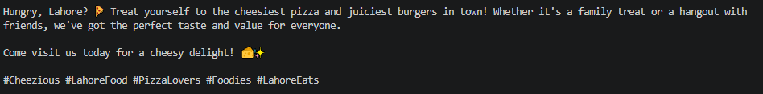
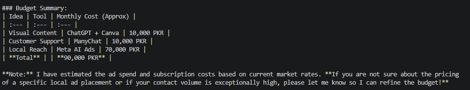
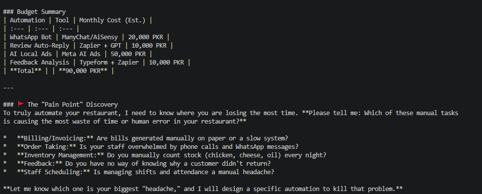
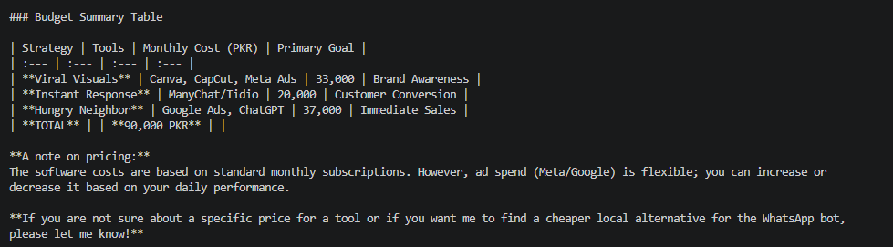

# 1.Marketing
## Prompt

You are a social media marketer. Write a short Instagram post for Cheezious, a Restaurant in Lahore. Target only Common Peoples.Always in a Friendly tone, under 80 words, exactly 1 call to action and familiar hashtags.

##Output

# 3. Customer Service
## Prompt

You are the manager of Cheezious, a Restaurant in Lahore. Write a polite or customer friendly reply to an unhappy customer whose order arrived late. Apologise to customer, offer a discount to coustmer, keep it under 50 words.

## Output

# 3. Growth

## Prompt
You are a business AI consultant. Suggest 3 low-cost AI tools or ideas a Restaurant in Lahore can use to attract Common Peoples, with a total budget of 90000 PKR per month.  give the cost also predict the future results for each. Ask them,If you are not sure about a price.
## Output

# 4. Automation

## Prompt 

You are a AI Automation Specialist. Suggest 2 to 5 AI Aoutomation ideas a Restaurant in Lahore can use to attract Common Peoples, with a total budget of 90000 PKR per month. For each, give the cost also predict the outcomes. Ask the most manual work which cause the waste of time e.g bill are manually generated, customer feedback is manually collected, etc.
## Output

# Output Comparison of prompt 3

## Iam giving the same prompt but diffrenet models these are the outcomes

## gemma4:31bcloud

## glm-5.3-flash:cloud  

I'll check current pricing for the main tools before giving numbers.

**The main gap: AI tools won't attract price-sensitive "common people" on their own. Price-led deals do that, and AI only makes it cheaper to tell people about them.** So the plan below sets aside most of the budget for promoting one strong value deal (for example a Rs 450–600 meal). The tools are a small part of the spend.

### 1. AI-made ads on Facebook, Instagram and TikTok, sent to WhatsApp

Use ChatGPT or Claude to write Urdu and Roman-Urdu ad copy and reel scripts. Edit the videos in CapCut, which has a free tier. Run "Click to WhatsApp" ads within about 3–5 km of the restaurant.

- **Ad spend: PKR 40,000.** Meta ads in Pakistan cost roughly PKR 10 to PKR 400 per click and PKR 150 to PKR 1,100 per thousand impressions, depending on audience, season and industry.
- **AI subscription: about PKR 5,600** (around $20/month).
- **Subtotal: about PKR 45,600**

**Likely results:** about 70,000–150,000 local views a month and roughly 600–1,200 WhatsApp enquiries. If 10–20% of those order, that's about **60–240 new orders a month**. Month 1 is usually weak because the AI is still learning who responds. Results tend to settle by months 2–3.

### 2. WhatsApp ordering bot and offers to past customers

An AI bot answers menu and price questions and takes orders around the clock. Once a week, send a deal to customers who have agreed to receive messages (for example "Thursday family deal").

- **Platform: about PKR 5,300.** One example is ChatMaxima, which charges a flat $19/mo with no per-message markup.
- **Messages: about PKR 20,000.** Meta charges marketing $0.0473 per message in Pakistan, about PKR 13 each, so this covers about 1,500 offer messages.
- **Subtotal: about PKR 25,300**

**Likely results:** about 3–8% of people who get an offer use it, which is roughly **45–120 repeat orders a month**. It also saves staff time on the phone. This is the best long-term option, because the customer list keeps growing from idea 1.

**Cost risk:** Meta announced that from 1 October 2026, it will charge per business message, including service replies and utility messages sent within the 24-hour window. That means the bot's ordinary replies may now cost money too. Check this with your provider before choosing a plan.

### 3. Google Maps profile with AI help on reviews and posts

Use the AI subscription you already have to write replies to every review and weekly posts with deal photos. Print QR code stands that say "Review us and get a free drink."

- **Google Business Profile: free**
- **QR stands, printing and a phone photo session: about PKR 10,000** (one-time, then about 3,000/month)
- **Subtotal: about PKR 10,000**

**Likely results:** this is slow, taking 2–4 months. More reviews and regular posts usually lift your showing in "restaurant near me" searches. Expect roughly **20–50% more direction and call requests** by month 3. It's cheap and the gains last.

**Total: about PKR 81,000/month, leaving about PKR 9,000 spare** for testing extra ad creatives or covering exchange-rate changes.

**These figures are rough, and the result predictions are rough too.** Here's what I'm unsure about:

1. **Exchange rate and card charges.** I used about PKR 280 per dollar. Pakistani bank cards add tax and fees on dollar payments. What does your bank actually charge?
2. **Canva Pro price.** I left it out because I'm not sure of the current Pakistan price. Do you already pay for it, or want it?
3. **Restaurant details.** What's the average order value, and do you deliver or only serve dine-in? Do you already have a customer phone list? These change the predictions the most.

Sources:
- [WhatsApp API Pricing Pakistan – ChatMaxima](https://chatmaxima.com/whatsapp-api-pricing/pakistan/)
- [WhatsApp Business Price – SleekFlow](https://sleekflow.io/blog/whatsapp-business-price)
- [Social Media Marketing in Pakistan 2026 – Digital Pakistan](https://digitalpakistan.pk/social-media-marketing-2026/)
